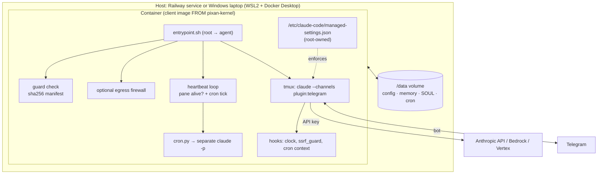

# pixan-kernel

A lean, client-agnostic kernel for running **Claude Code as an always-on agent in a container**,
talking to people through the official Claude Code **Telegram plugin**. The same image runs on
**Railway** or on a **Windows laptop** (WSL2 + Docker Desktop).

The kernel gives every agent the same boring, tested foundation — boot, guards, heartbeat,
scheduled tasks, rich messages — so each client repo only adds what makes it unique: its soul,
identity and skills.

> Status: batch 1 (foundation). See [Roadmap](#roadmap).

## Architecture



## Layers

| Layer | Lives in | Contains |
|---|---|---|
| **Kernel** (this repo, public) | `ghcr.io/pixan-ai/pixan-kernel` | Debian base, non-root `agent` user, Bun, entrypoint, heartbeat, `cron.py`, `send_rich.py`, `patch_rich_message.py`, `ssrf_guard.py`, `clock.py`, managed settings, firewall. **No Claude Code.** |
| **Client** (private repo per client) | `FROM ghcr.io/pixan-ai/pixan-kernel@sha256:…` | Pinned Claude Code, `SOUL.md`, `IDENTITY.md`, skills, client config. See [`examples/client/`](examples/client/). |
| **Runtime data** | `/data` volume | `CLAUDE_CONFIG_DIR=/data/config`, workspace, memory, scheduled tasks, Telegram access list. |

Why Claude Code is not in the kernel image: each client installs (and therefore accepts the terms for)
a pinned version in its own build, and updates ship as new, tested images (`DISABLE_AUTOUPDATER=1`).

```
Dockerfile                     kernel base image
kernel/entrypoint.sh           boot → guards → auth → seed → tmux → heartbeat
kernel/managed-settings.json   deny rules + hooks (installed root-owned in /etc/claude-code)
kernel/bin/                    cron, send_rich, patch_rich_message, ssrf_guard, clock
kernel/seed/                   user settings (plugins), access.json, CLAUDE/SOUL/IDENTITY, skills
kernel/firewall/               optional egress allowlist
examples/client/               template for a private client image
deploy/railway/  deploy/windows/
tests/                         L0 static+unit · L1 entrypoint · L2 image smoke
```

## Features (batch 1)

- **Telegram** via the official `telegram@claude-plugins-official` plugin; only the owner is allowed on first boot.
- **Heartbeat**: every `HEARTBEAT_SEC` (30 s) the kernel checks the Claude pane is actually alive
  (a zombie is not alive) and exits 1 if not, so the platform restarts the container.
- **Scheduled tasks** (`cron.py` + `scheduled-tasks` skill): survive restarts, run in a separate
  `claude -p` so they never freeze the live chat, at most one per beat, no flooding.
- **Rich messages** (`send_rich.py`, `patch_rich_message.py`): HTML, tables, images to allowed chats only.
- **SSRF guard** on `WebFetch` (blocks private/loopback/metadata addresses).
- **Advisor tool** (optional, off by default) — see below.

## Install

### Build the client image (both targets)

1. Create a private repo from [`examples/client/`](examples/client/). Edit `SOUL.md`, `IDENTITY.md`, `skills/`.
2. Pin `KERNEL_IMAGE` to a digest and `CLAUDE_CODE_VERSION` to a tested version.
3. Build and push to your private registry: `docker build -t ghcr.io/your-org/your-agent:1 . && docker push …`

### Railway

See [`deploy/railway/README.md`](deploy/railway/README.md): service from the client repo, volume at `/data`,
variables `ANTHROPIC_API_KEY` (or another credential, see Auth model), `TELEGRAM_BOT_TOKEN`, `OWNER_TELEGRAM_ID`, `AGENT_NAME`. Look for `heartbeat OK`.

### Windows laptop (WSL2 + Docker Desktop)

See [`deploy/windows/README.md`](deploy/windows/README.md). In short:

1. Dedicated Windows account, BitLocker on, WSL2 + Docker Desktop (start at sign-in).
2. `copy .env.example .env` and fill it (`CLIENT_IMAGE` pinned by digest).
3. Elevated PowerShell: `.\install.ps1` — locks `.env`, disables sleep on AC, starts the container.
4. Back up the `<AGENT_NAME>-data` volume daily to an IT-approved location.

### Environment

| Variable | Required | Meaning |
|---|---|---|
| `ANTHROPIC_API_KEY` | one of* | The person's own Console API key (recommended). |
| `CLAUDE_CODE_OAUTH_TOKEN` | one of* | The owner's own subscription token, for their own individual use. *Or `ANTHROPIC_AUTH_TOKEN`, an `apiKeyHelper`, or `CLAUDE_CODE_USE_BEDROCK/VERTEX/FOUNDRY=1` with their env. See Auth model. |
| `TELEGRAM_BOT_TOKEN`, `OWNER_TELEGRAM_ID` | yes | Bot token and the owner's numeric Telegram ID. |
| `AGENT_NAME`, `AGENT_LANGUAGE` | no | Defaults `agent`, `English`. |
| `TZ` | no | Default `America/Mexico_City`. |
| `KERNEL_FIREWALL`, `KERNEL_EGRESS_ALLOW`, `KERNEL_EGRESS_ALLOW_CIDR` | no | Optional egress allowlist. |
| `KERNEL_CRON` | no | `0` disables scheduled tasks. |
| `PIXAN_ADVISOR_MODEL` | no | Unset = advisor off. `opus`, `sonnet` or a full model id. |

## Auth model

Each person uses **their own** Anthropic credential, generated by them and set in their own environment,
and is billed by Anthropic (or their cloud provider) directly. The project never receives, stores or pays
for anyone's credential. The kernel never logs, copies or sends credentials; it logs only the *name* of the
variable in use (`auth: ANTHROPIC_API_KEY`).

The agent boots with at least one of these. When several are set, the kernel resolves them in Claude Code's
own precedence, so the logged name is the one actually used: cloud (`CLAUDE_CODE_USE_BEDROCK` /
`_VERTEX` / `_FOUNDRY`) > `ANTHROPIC_AUTH_TOKEN` > `ANTHROPIC_API_KEY` > `apiKeyHelper` (managed settings) >
`CLAUDE_CODE_OAUTH_TOKEN`.

| Credential | Notes |
|---|---|
| `ANTHROPIC_API_KEY` | **Recommended** for agents that serve other people or Telegram groups. Console key, usage-billed. |
| `CLAUDE_CODE_OAUTH_TOKEN` | A Claude subscription token (`claude setup-token`). Meant for the owner's own ordinary individual use; its limits assume that use and Anthropic may enforce its terms. We make no promise that a subscription may be used for an always-on agent or for groups. Team/Enterprise subscriptions: an Owner must enable channels for the organization. |
| `ANTHROPIC_AUTH_TOKEN` / `apiKeyHelper` | Bearer token or key helper (e.g. a company gateway). |
| `CLAUDE_CODE_USE_BEDROCK=1` / `_VERTEX=1` / `_FOUNDRY=1` | Your own cloud account and its env. The agent runs **without Telegram channels** there (boot logs a `WARN`). |

If none is set, the boot logs `MISSING credential` with every option and exits 1.

**OAuth token plus anything ranked above it:** the higher one wins and the log shows a `WARN`. `claude -p` (scheduled tasks)
always uses the key when present, while the interactive session uses it only once it is approved; without
one rule, chat and cron could bill different accounts. So the kernel drops the token from the environment of
both (L1 asserts the Claude pane has no token) and pre-approves the key in `/data/config/.claude.json` by its last 20 characters only (how Claude Code
records approved keys); the full key stays in the environment. With a token only, nothing is written to
`customApiKeyResponses`, and the token is never copied to the volume.

If Claude fails to start, gets stuck on a setup screen, or a scheduled run fails, the message names the
credential in use so you know which one to check. If the screen shows the credential is rejected
(`Invalid API key`, `OAuth access token is invalid`, ...), the owner gets **one** Telegram alert naming it and the
agent is not restarted (a restart cannot fix a credential). A one-time real-credential lab test is in
[docs/lab-auth-checklist.md](docs/lab-auth-checklist.md) (not run in CI).

## Security model

Based on Anthropic's [Development containers](https://docs.anthropic.com/en/docs/claude-code/devcontainer) guidance:

- **Container isolation.** "commands Claude runs execute inside it rather than on the host machine".
- **Non-root.** "Because the container runs Claude Code as a non-root user and confines command execution to
  the container, you can pass `--dangerously-skip-permissions` for unattended operation." The entrypoint starts
  as root only to verify guards, set up the firewall and fix volume ownership, then drops to `agent` (uid 1000).
- **Managed settings** at `/etc/claude-code/managed-settings.json` (root-owned, highest precedence): deny rules
  (destructive commands, `.env`, credentials, editing kernel files), auto-mode hard-deny rules, and hooks
  (clock, SSRF guard, cron context). Clients add rules in their own user/project settings; they cannot loosen these.
- **Boot guard check.** A sha256 manifest of the kernel files is built into the image; if a client layer
  overwrites a guard, the container refuses to start. (This catches mistakes, not a hostile image builder.)
- **Optional egress firewall** following the reference `init-firewall.sh` pattern ("limits outbound traffic"):
  default deny, allow DNS, Anthropic, Telegram, GitHub and any extra hosts you list. Needs `NET_ADMIN`.
- **Secrets**: never baked into images; the bot token file is `0600`; don't mount host `~/.ssh` — use
  scoped, short-lived tokens, as the same page recommends.
- Anthropic's own caveat applies: "While the dev container provides substantial protections, no system is
  completely immune to all attacks."

## Advisor tool (optional, experimental)

Claude Code's [advisor tool](https://code.claude.com/docs/en/advisor) lets the main model consult a stronger
model at key decision points. It is **off by default**. Set `PIXAN_ADVISOR_MODEL=opus` (or `sonnet`, or a full
model id) and the kernel writes `advisorModel` into the user settings at boot (the setting, not the
`--advisor` flag, so a bad pairing never blocks the boot).

- Experimental: behavior, pricing and availability may change, and it **may use more tokens** (billed at the
  advisor model's rates).
- The advisor must rank **at or above** the main model, otherwise it is silently not attached.
- Requires Claude Code **≥ v2.1.260** and the Anthropic API (not Bedrock/Vertex). Variables that turn off
  feature-flag fetching (e.g. `DISABLE_TELEMETRY`) keep it off.
- `CLAUDE_CODE_DISABLE_ADVISOR_TOOL=1` hard-disables it regardless of `PIXAN_ADVISOR_MODEL`.

## Tests (acceptance first)

| Level | Runs | Proves |
|---|---|---|
| L0 `tests/l0-static.sh` | shellcheck, hadolint, JSON/YAML/TOML, Python unit tests, gitleaks | files are sane; cron, guards, rich messages behave; base image has no Claude Code; advisor off when unset |
| L1 `tests/l1-unit.sh` | entrypoint with a stub `claude` | auth precedence (OAuth, key, both, AUTH_TOKEN, Foundry), missing credential fails fast, no token in the pane env, boot order, seeding rules, setup-screen detection; heartbeat: zombie, hung Claude, no `bun server.ts`, dropped channel → exit 1; dead credential → one owner alert, no restart |
| L2 `tests/l2-docker.sh` | real image + stub client layer, `--network none` | image builds, guards are `root:644`, tampered guard refuses boot, heartbeat on `/data`, killed Claude → container exits 1 |

CI runs all three on every PR; pushes to `main` also publish `ghcr.io/pixan-ai/pixan-kernel`.

## Roadmap

- **Batch 2**: the 9 optional plugins; ElevenLabs voice (shipped without a token); Slack (off by default);
  autoupdate with automatic rollback to the Beta canary's last-known-good image digest; scheduled,
  encrypted volume backups.
- Later: Teams channel, wake-on-message.

## License

[Apache-2.0](LICENSE).
